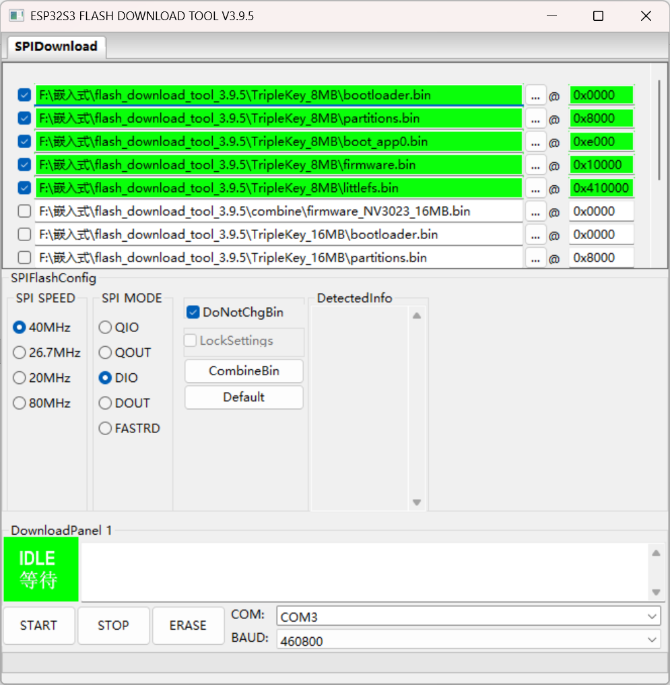

# 打包构建

## 发布脚本

项目使用 `scripts/release.py` 进行固件发布，支持构建固件、生成文件系统镜像、合并为完整固件。

### 基本用法

```bash
# 默认环境，执行全部（构建固件 + 文件系统 + 合并）
python scripts/release.py

# 指定环境
python scripts/release.py -e NV3023_8MB

# 多个环境
python scripts/release.py -e NV3023_8MB -e GC9107_16MB

# 全部环境
python scripts/release.py --all-envs
```

### 构建模式

可单独执行某个步骤，不指定则默认全部执行：

```bash
python scripts/release.py --firmware          # 仅构建固件
python scripts/release.py --fs                # 仅构建文件系统镜像
python scripts/release.py --merge             # 仅合并（需先构建过）

# 组合使用
python scripts/release.py --firmware --merge  # 构建固件后合并，跳过文件系统
```

### 输出文件

输出到上级目录 `Firmware/`，每个环境生成三个文件：

| 文件 | 后缀 | 内容 | 用途 |
|------|------|------|------|
| `TripleKey_{env}_V{version}.bin` | 无 | 完整固件（bootloader+partitions+firmware+littlefs） | Flash Download Tool / esptool 整包烧录 |
| `TripleKey_{env}_V{version}_ota.bin` | `_ota` | 仅 app 分区（firmware.bin） | OTA 远程更新 |
| `TripleKey_{env}_V{version}_fs.bin` | `_fs` | 仅文件系统（littlefs.bin） | 单独更新文件系统 |

### 整包烧录地址

完整固件由以下组件按地址拼接而成（地址来自分区表 `custom_8MB.csv` / `custom_16MB.csv`）：

| 组件 | 地址 | 来源 |
|------|------|------|
| bootloader.bin | 0x0 | `.pio/build/{env}/` |
| partitions.bin | 0x8000 | `.pio/build/{env}/` |
| boot_app0.bin | 0xe000 | `build_notes/bin/` |
| firmware.bin | 0x10000 | `.pio/build/{env}/` |
| littlefs.bin | 0x410000 | `.pio/build/{env}/` |

### 单独合并工具

`scripts/merge_firmware.py` 可在已有构建产物的情况下单独执行合并，不触发构建：

```bash
python scripts/merge_firmware.py                 # 合并默认环境
python scripts/merge_firmware.py -e NV3023_8MB   # 合并指定环境
python scripts/merge_firmware.py --all            # 合并全部环境
```

输出到 `Software/temp_firmware/` 目录。

## 旧方法

早期使用乐鑫官方 flash_download_tool_3.9.5 手动合并，现已由脚本替代。

